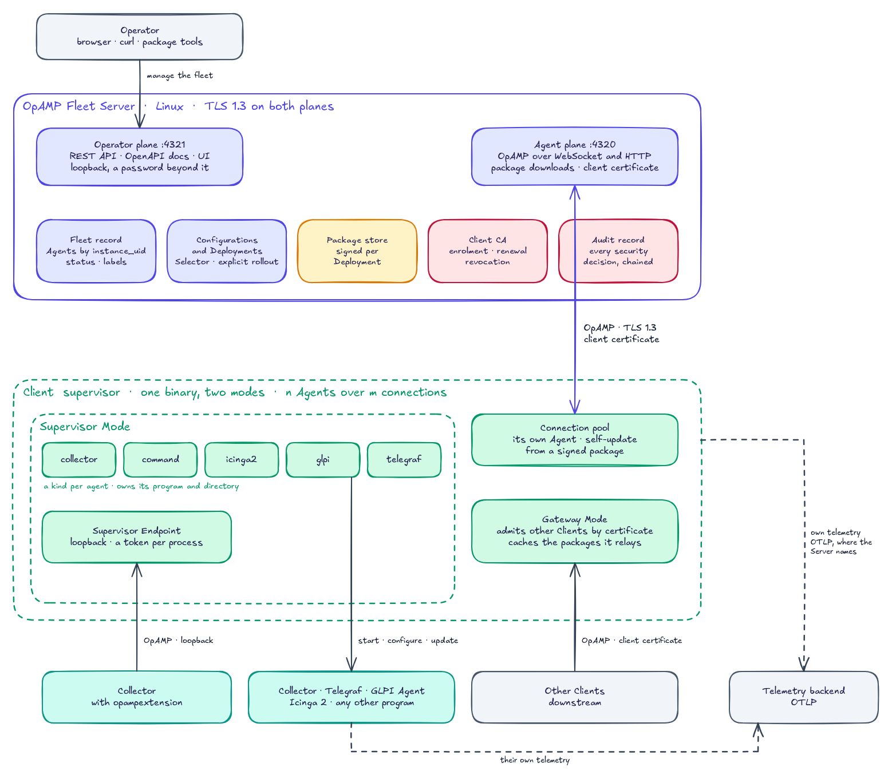

# OpAMP Fleet

**OpAMP Fleet** manages a fleet of telemetry agents over OpenTelemetry
[OpAMP](https://opentelemetry.io/docs/specs/opamp/), written in Rust: a **Server** that decides what
every agent runs, and a **Client** that runs the agents of a host and reports what they really run
— OpenTelemetry Collectors and agents that never spoke OpAMP alike.

> **📖 Running it? Read the [User Manual](docs/manual/README.md).** Setting up a fleet for the
> first time? Start with [Setting up a fleet](docs/manual/setup.md).

> Working on it? The rules for humans and coding agents alike are in [`AGENTS.md`](AGENTS.md).

## Overview

A fleet of agents, each configured by a local file, drifts: changing what a hundred agents do means
reaching a hundred machines, and nobody can say for certain what each one actually runs. OpAMP
closes that loop — an agent takes its configuration over the protocol and reports back what it
applied and how it is doing. OpAMP Fleet implements both ends:

- **Server** — an API-first control plane on Linux. It holds what the fleet should run, tracks what
  each agent reports, and reconfigures only an agent whose configuration differs. Its contract is
  an OpenAPI-described REST API, so any portal can drive it; the bundled UI is deliberately simple.
- **Client** — one process, installed as an OS service on Linux, macOS and Windows, that updates
  itself from a signed package. In **Supervisor Mode** it runs many Supervisors, each managing one
  process; in **Gateway Mode** it folds other Clients' connections onto a few upstream ones. Both
  modes combine on one host.
- **Kinds behind a hexagonal core** — a Supervisor's kind knows its agent: `collector` serves every
  OpenTelemetry Collector, `command` runs any other program and watches it from outside. A new kind
  of agent is a new kind behind the same ports; the core does not change.
- **The protocol on the record** — both ends implement OpAMP as completely as it allows, against a
  pinned version, and [`docs/CONFORMANCE.md`](docs/CONFORMANCE.md) states each capability's status.

The [specification](docs/SPECIFICATION.md) holds the goals, the vocabulary and the non-goals; the
[Architecture Decision Records](docs/adr/) hold the reasoning behind every structural choice.
[`docs/HARDENING.md`](docs/HARDENING.md) collects candidate hardening measures as a backlog.

## Architecture

*The image carries its [Excalidraw](https://excalidraw.com) scene: open the PNG there to edit it,
and export it again with "Embed scene" switched on.*

The Server sees only **Agents**, told apart by `instance_uid` and never by the connection that
carried them: a Supervisor's process, a Collector reporting through its own `opampextension`, and a
Client several hops behind a Gateway look alike to it. Every connection to the **Agent plane** is
TLS 1.3 with a client certificate, which the Server's CA issues once an operator approves a host's
enrolment. The **Operator plane** — the REST API and the UI — is a listener of its own and stays on
the loopback unless it is published behind a password. How the code is cut into crates and modules
is in [`docs/ARCHITECTURE.md`](docs/ARCHITECTURE.md).

## Prerequisites

- [VS Code](https://code.visualstudio.com/) with the
  [Dev Containers](https://marketplace.visualstudio.com/items?itemName=ms-vscode-remote.remote-containers)
  extension, or any DevContainer-compatible IDE
- Docker / Podman (rootless) available on the host
- Outside the Dev Container: bash 4.4 or later for the checks, 3.2 for the git hooks
  ([ADR-0002](docs/adr/0002-decisions-verified-by-tests.md)); macOS ships 3.2

## Getting Started

1. Open the repository in VS Code and choose **Reopen in Container**. The Dev Container and the
   preconfigured agent extensions build automatically, and the container enables the repository's
   git hooks with the merge settings they rely on ([Git hooks](CONTRIBUTING.md#git-hooks)). Working
   outside the container? Run the three commands listed there yourself, once per clone.
2. Authenticate your coding agent inside the container (for Claude Code: `claude login`).
3. Start working with the agent. Drive the work from the specification and the ADRs.

## Build, Test & Run

One Cargo workspace on Rust stable, which the Dev Container provides; its five crates are described
in [`docs/ARCHITECTURE.md`](docs/ARCHITECTURE.md). This section is the single source of the build,
test and run commands, for humans and agents alike. [`scripts/check-rust.sh`](scripts/check-rust.sh)
runs the build, test and lint commands and the first two rows of the table below, locally through
`scripts/check-all.sh` before every push and in CI as the `rust` job of
[`checks.yml`](.github/workflows/checks.yml); [`ci.yml`](.github/workflows/ci.yml) release-builds
the Client for Linux, Windows and macOS and the Server for Linux.

- **Build:** `cargo build --workspace`
- **Test:** `cargo test --workspace`
- **Lint:** `cargo fmt --all --check && cargo clippy --workspace --all-targets -- -D warnings`
- **Make development certificates:** `scripts/dev-pki.sh` writes them, a `server.toml` and a
  `supervisor.toml` to `.dev-pki/`; `scripts/seed_test_configs.sh --enrol` approves the development
  Client's enrolment
- **Run the Server:** `cargo run -p fleet-server -- --config .dev-pki/server.toml`
- **Run the Client:** `cargo run -p fleet-agent -- --config .dev-pki/supervisor.toml`
- **Run the operator tool:** `cargo run --bin opamp-fleetctl -- package fetch` (a known agent's
  release, handed to the Server), `-- package --help` (build, hash and sign an artifact) or
  `-- pki --help` (the fleet's certificates), documented in [the manual](docs/manual/tools.md)

The checks beyond these, each for what the plain build cannot show:

| Check | Command | When, and what it needs |
|---|---|---|
| `opamp` per feature | `for f in "" client server; do cargo clippy -p opamp --all-targets --no-default-features --features "$f" -- -D warnings; done` | each feature stands alone (ADR-0008); run by `check-rust.sh` |
| fewer Supervisor kinds | `cargo clippy -p fleet-agent --all-targets --no-default-features -- -D warnings && cargo test -p fleet-agent --no-default-features` | a build leaving a wrapped kind out compiles and refuses its `type` (ADR-0046); run by `check-rust.sh` |
| Windows build | `cargo xwin clippy -p fleet-agent --all-targets --target x86_64-pc-windows-msvc -- -D warnings` | on a change to platform-gated code; needs `cargo install cargo-xwin` and `rustup target add x86_64-pc-windows-msvc`; CI builds the Client on Windows |
| supply chain | `cargo deny check` | as [`deny.toml`](deny.toml) sets it; needs `cargo install cargo-deny`; the `Security audit` workflow runs it weekly and on lockfile changes |
| fuzzing | `cargo +nightly fuzz run <target> fuzz/corpus/<target> fuzz/seeds/<target>` | the targets are in [`fuzz/Cargo.toml`](fuzz/Cargo.toml); needs `cargo install cargo-fuzz` and nightly; the `Fuzz` workflow runs them daily |
| interop with `opamp-go` | `cargo test -p fleet-agent --test interop_opamp_go -- --ignored --nocapture --test-threads=1` | needs a Go toolchain, which the Dev Container does not ship; the `Interop` workflow runs it weekly; see [`interop/README.md`](interop/README.md) |
| the stores | `scripts/check-store.sh s3` and `scripts/check-store.sh postgres` | against a real S3-compatible store and PostgreSQL, named by the `FLEET_TEST_S3_*` and `FLEET_TEST_POSTGRES_*` variables, and `postgres` against a bucket too, for a Server on both; [`observability/`](observability/README.md) provides them; `check-all.sh` runs both when they are named, and so do the `s3-store` and `postgres-store` jobs on every pull request |
| service smoke | `FLEET_SMOKE_THROWAWAY=1 scripts/check-service-smoke.sh` | registers services and accounts, so a throwaway machine only; see [below](#the-service-smoke-test) |

Both binaries read a TOML file; every setting has a default except the TLS material. The annotated
examples are in [`config/`](config/).

### Releases

The version is `[workspace.package] version` in [`Cargo.toml`](Cargo.toml), so bumping it is a
reviewed commit. The `Release` workflow makes the `version/*` tag from it, then builds and publishes
the Client's archive and native packages per platform, the operator tool, an SBOM beside each,
`SHA256SUMS`, and the Server's image `ghcr.io/mbrigl/opamp-fleet-server:<version>`, every one
attested (ADR-0038, ADR-0039). Started with `dry_run`, the default, it builds everything and
publishes nothing. How an operator checks a download is in
[the manual](docs/manual/tools.md#getting-it), and the image in
[the Server's manual](docs/manual/server.md#in-a-container).

### The service smoke test

The `Service smoke` workflow installs the Client as a real service on Linux, macOS and Windows,
weekly and on demand: install, start, the Agent appearing in the fleet, its process killed and
restarted by the manager, a stop that stays stopped, uninstall, and an install that enrols with a
`bootstrap.p12`. Its test is `#[ignore]`d, so an ordinary `cargo test` installs nothing.

What still needs a human, per platform:

- starting at **boot**, the service's [log](docs/manual/client.md#where-the-services-logs-are), and
  the Agent in the fleet UI;
- an **SELinux-enforcing host**: the `.rpm` install must start, and a service dying with
  `status=203/EXEC` and an AVC denial is the failure ADR-0020 clause 12 prevents;
- each wrapped kind under the packaged account `opamp-fleet` and under `--run-as root`: it starts,
  reports, and its `sudo` or setuid helpers still work (ADR-0021).

## Usage

The [quick start](docs/manual/README.md#quick-start-a-closed-loop-on-one-machine) in the User Manual
closes the loop on one machine: a Server, a Client, a Configuration rolled out through a
Deployment, and the Agent reporting it applied. From there:

- [Setting up a fleet](docs/manual/setup.md) — the certificates, both configurations, enrolment;
- [Rollout walkthrough](docs/manual/rollout.md) — an artifact built, signed, uploaded, rolled out;
- [Running the Client as an OS service](docs/manual/client.md#running-it-as-an-os-service);
- [Several Server instances](docs/manual/server.md#several-instances) on PostgreSQL and S3, with
  the records moved by `server migrate-to-postgres` and the artifacts by `server blobs-to-s3`;
- [the REST API](docs/manual/server.md#the-rest-api), whose contract is the OpenAPI document at
  `/api/v1/openapi.json`.

## Template

- **Template release:** v0.8.1 — the release of [NUC](https://github.com/hivevm/nuc) this
  repository carries; a project moves the line when it takes up a later one
  ([ADR-0005](docs/adr/0005-template-releases.md)).

## Contributing

See [`CONTRIBUTING.md`](CONTRIBUTING.md) for the workflow (specification- and ADR-driven, small
reviewable changes), the project layout, the Dev Container, the coding agents, the git hooks, the
integration branches, and the repository settings, and [`CODE_OF_CONDUCT.md`](CODE_OF_CONDUCT.md)
for the community standards we expect of everyone taking part. Security issues: please follow
[`SECURITY.md`](SECURITY.md) instead of opening a public issue.

## License

Released under the Apache License 2.0 — see [`LICENSE`](LICENSE) and [`NOTICE`](NOTICE).
